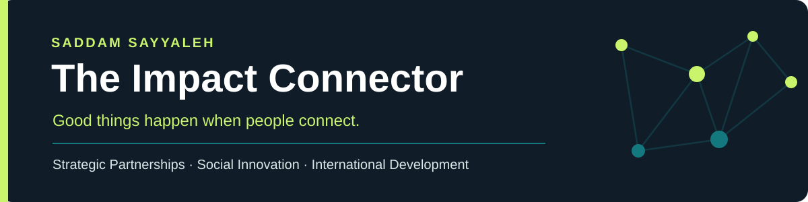

### Build. Connect. Grow.

**Strategic Partnerships, Social Innovation & International Development**

[**Explore The Impact Connector**](https://saddamsayyaleh.wordpress.com/) · [**Professional experience**](https://saddamsayyaleh.wordpress.com/experience/) · [**Connect on LinkedIn**](https://www.linkedin.com/in/saddamsayyaleh/)

---

## About me

I’m **Saddam Sayyaleh**, an international development and social innovation professional working across organisational growth, strategic partnerships, programme development and institutional engagement.

I founded **I Learn** in Jordan in 2012 and subsequently helped establish its formal operating organisation, **NasJo for Training**, in 2018. My later experience includes regional development and partnership leadership at **Anera**, institutional engagement, and independently commissioned research and advisory assignments.

**The Impact Connector** brings these interests together: developing connections that help organisations establish themselves, strengthen their position and turn opportunities into practical action.

## Applied tools and methodologies

This GitHub profile documents selected methods, practical resources and developing experiments. **Responsible AI and digital innovation are emerging areas of exploration**, not claims of a completed AI engineering or transformation consultancy portfolio.

### Featured: AI Readiness & Workflow Lab

**Designed and authored by Saddam Sayyaleh | The Impact Connector**

A bilingual technical demonstration combining an organisational AI readiness self-assessment with *Ali’s Reporting Challenge*, an illustrative nonprofit workflow redesign exercise.

The model follows **Assess → Evaluate → Prioritise → Plan**. It helps visitors examine reporting bottlenecks, compare process and AI interventions, consider governance safeguards and explore implementation choices.

**[▶ Launch the interactive lab](https://saddamsayyaleh.github.io/saddamsayyaleh/)** · **[Visit the WordPress introduction](https://saddamsayyaleh.wordpress.com/ai-workflow-lab/)**

| Explore the model | Technical resources |
| --- | --- |
| [Bilingual interactive application](docs/index.html) | [Methodology and limitations](docs/docs/methodology.md) |
| [Assessment specification and scoring](docs/docs/assessment_specification.md) | [Synthetic case datasets](docs/data/) |

> **Evidence boundary:** Ali and the organisation are illustrative. All case figures are constructed assumptions, not measured client outcomes. The readiness assessment is an indicative learning tool, not an independently validated certification.

## Areas of professional practice

**Strategic partnerships and institutional development** — building and strengthening relationships among organisations, funders and institutions.

**Organisational growth and social innovation** — developing initiatives, institutional positioning and collaborative models that can be sustained.

**Programme strategy, research and stakeholder engagement** — consultation, qualitative analysis, ecosystem research and facilitation.

**Emerging practice: responsible AI and digital tools** — exploring how workflow assessment, better organisational information and appropriate safeguards can support adoption.

## Connect

- **Website:** [The Impact Connector](https://saddamsayyaleh.wordpress.com/)
- **LinkedIn:** [Saddam Sayyaleh](https://www.linkedin.com/in/saddamsayyaleh/)
- **Expertise and advisory focus:** [Areas of expertise](https://saddamsayyaleh.wordpress.com/expertise/)
- **AI Workflow Lab:** [Try the assessment](https://saddamsayyaleh.github.io/saddamsayyaleh/)

*Good things happen when people connect.*
